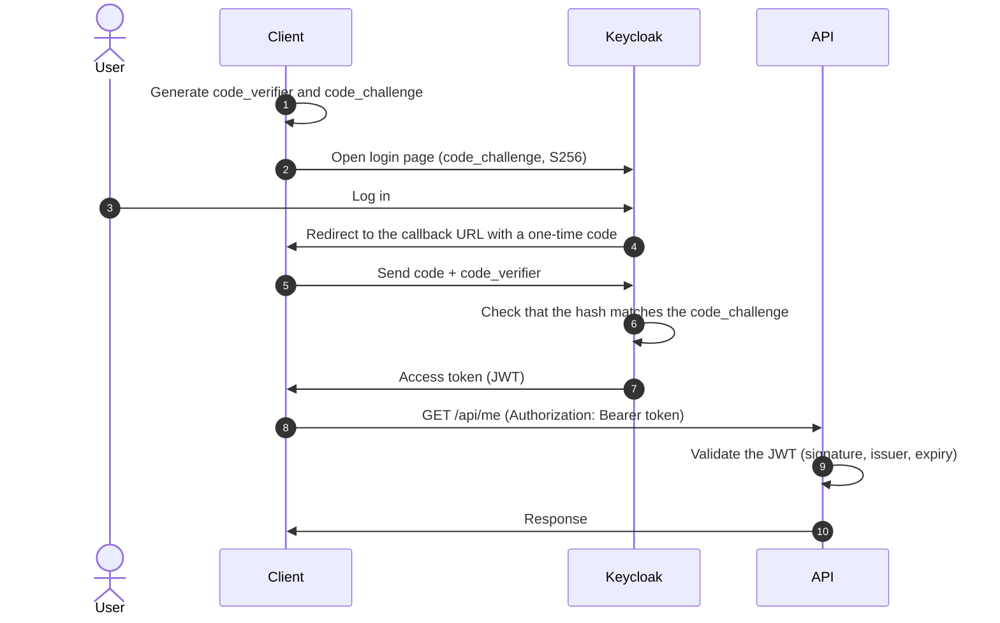

# 🔐 Authorization Code Flow with PKCE

A demo of the **OAuth 2.0 Authorization Code Flow with PKCE**: the user logs in, the client exchanges a one-time code
for an access token and uses it to call a protected API.

Everything runs locally with Docker Compose.

## 🧩 Components

| Component            | Role                                                                                                                                                   |
|:---------------------|:-------------------------------------------------------------------------------------------------------------------------------------------------------|
| **Nginx**            | TLS termination and routing: `https://auth.develop.local` → Keycloak, `https://develop.local` → API.                                                   |
| **Keycloak**         | Authorization server. Authenticates users, enforces PKCE (`S256`), issues signed JWT access tokens and publishes public keys for signature validation. |
| **Spring Boot API**  | Stateless resource server. Validates the JWT (signature, issuer, expiry) and reads user roles from it. No login page, no session.                      |
| **Client** (Postman) | Public client without a secret. Generates the PKCE values, runs the login and exchanges the code for a token.                                          |

## 🤔 Why this flow?

**The problem.** Single-page and mobile apps are *public clients*: their code is readable by anyone, so they cannot keep
a `client_secret`. The authorization server has no way to verify who is requesting a token.

**Authorization Code Flow.** After login, Keycloak does not return the token in the redirect URL. It returns a
short-lived, one-time **code**, which the app exchanges for a token in a direct request to Keycloak.

**The weak point.** The code travels through the browser in a redirect URL, so it can leak via the browser history, an
extension or a malicious app registered for the same redirect. Without a secret, whoever holds the code can exchange it
for a token.

## 🔑 How PKCE works

PKCE (Proof Key for Code Exchange, [RFC 7636](https://datatracker.ietf.org/doc/html/rfc7636)) binds the code to the
client that started the login:

1. **Start of login.** The client generates a random `code_verifier` and sends its hash, the `code_challenge`, in the
   authorization request. Keycloak stores the challenge.
2. **End of login.** The client sends the `code` together with the original `code_verifier`.
3. **Check.** Keycloak hashes the `code_verifier` and compares it with the stored `code_challenge`. If they match, it
   issues the token; otherwise it rejects the request.

```text
code_verifier  = dBjftJeZ4CVP-mB92K27uhbUJU1p1r_wW1gFWFOEjXk    stays in the client
code_challenge = E9Melhoa2OwvFrEMTJguCHaoeK1t8URWbuGJSstw-cM    sent to Keycloak
                 (code_challenge = BASE64URL(SHA256(code_verifier)))
```

A hash cannot be reversed, so an attacker who intercepts the `code_challenge` and the `code` still cannot get a token
without the `code_verifier`.

## 🔄 How it works



## 🚀 Run it

You need Docker with Docker Compose.

**1. Add the host names** to your `hosts` file (`/etc/hosts` on Linux and macOS,
`C:\Windows\System32\drivers\etc\hosts` on Windows):

```text
127.0.0.1 develop.local auth.develop.local
```

**2. Make local HTTPS certificates** (example with [mkcert](https://github.com/FiloSottile/mkcert)):

```bash
mkcert -install
mkdir -p infra/certs/ssl infra/certs/ca

mkcert -cert-file infra/certs/ssl/develop.local.pem \
       -key-file  infra/certs/ssl/develop.local-key.pem  develop.local

mkcert -cert-file infra/certs/ssl/auth.develop.local.pem \
       -key-file  infra/certs/ssl/auth.develop.local-key.pem  auth.develop.local

cp "$(mkcert -CAROOT)/rootCA.pem" infra/certs/ca/rootCA.pem
```

**3. Create the `.env` file.** Copy ` .env.example` to `.env` and fill in the values:

| Variable                                                               | Value                                  |
|:-----------------------------------------------------------------------|:---------------------------------------|
| `KC_BOOTSTRAP_ADMIN_USERNAME`, `KC_BOOTSTRAP_ADMIN_PASSWORD`           | Admin account for the Keycloak console |
| `KC_POSTGRES_DATABASE`, `KC_POSTGRES_USERNAME`, `KC_POSTGRES_PASSWORD` | Keycloak database                      |

**4. Start everything:**

```bash
docker compose up -d --build
```

Wait about one minute. Keycloak must start and import the realm.

## 🧪 Testing with Postman

### Step 1: Disable SSL verification

In Postman: **Settings** (⚙) → **General** → turn off **SSL certificate verification**. Alternatively, add
`rootCA.pem` under **Settings** → **Certificates** → **CA certificates**.

### Step 2: Configure the request authorization

1. Create a request to `https://develop.local/api/me`.
2. Open the **Authorization** tab and choose **OAuth 2.0**.
3. Fill in these fields:

| Field                       | Value                                                                                  |
|:----------------------------|:---------------------------------------------------------------------------------------|
| **Grant Type**              | `Authorization Code (With PKCE)`                                                       |
| **Callback URL**            | `https://oauth.pstmn.io/v1/callback`                                                   |
| **Authorize using browser** | Checked (or use the built-in Postman webview)                                          |
| **Auth URL**                | `https://auth.develop.local/realms/realm-auth-code-pkce/protocol/openid-connect/auth`  |
| **Access Token URL**        | `https://auth.develop.local/realms/realm-auth-code-pkce/protocol/openid-connect/token` |
| **Client ID**               | `client-service-web`                                                                   |
| **Client Secret**           | *(leave blank)*                                                                        |
| **Code Challenge Method**   | `S256`                                                                                 |
| **Code Verifier**           | *(leave blank, Postman generates it)*                                                  |
| **Scope**                   | `openid profile email`                                                                 |
| **Client Authentication**   | `Send client credentials in body`                                                      |

### Step 3: Get the token and call the API

1. Click **Get New Access Token**.
2. Log in on the Keycloak page with `admin` / `admin` or `user` / `user`.
3. Click **Use Token**.
4. Click **Send**. You get `200 OK` with your user data.
