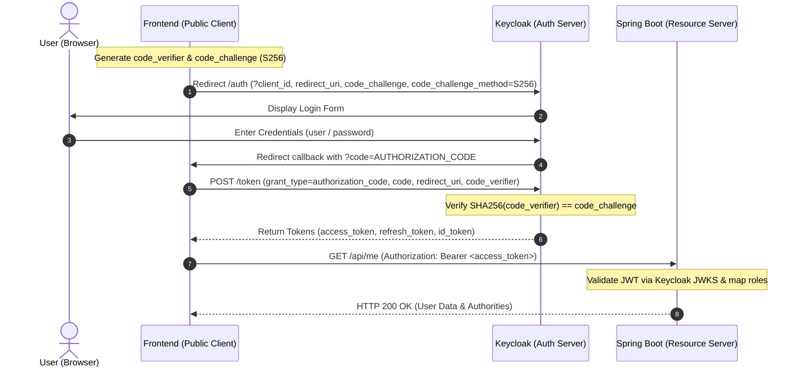

# 🔐 OAuth 2.0 Authorization Code Flow with PKCE

This module demonstrates the **OAuth 2.0 Authorization Code Flow with PKCE (Proof Key for Code Exchange)** using
**Keycloak** as the Identity Provider and **Spring Boot** as a stateless **Resource Server**.


## 🌟 Architectural Pattern

```text
┌────────────────┐          1. Authenticate & Obtain Token          ┌───────────────────┐
│                │ ◄──────────────────────────────────────────────► │                   │
│  Frontend App  │                                                  │     Keycloak      │
│ (Public Client)│          2. Validate Public Keys (JWKS)          │ (Identity Server) │
│                │                   ┌────────────────────────────► │                   │
│                │ 3. Call API       │                              └───────────────────┘
│                │    with Bearer    ▼
│                │ ───────────────► ┌───────────────────┐
│                │                  │    Spring Boot    │
│                │ ◄─────────────── │ (Resource Server) │
└────────────────┘   4. Response    └───────────────────┘
```

- **Frontend (Public Client)**: Interacts directly with Keycloak to authenticate users and receive tokens
  (`access_token`, `refresh_token`, `id_token`). It stores tokens locally (e.g., in memory) and attaches the
  `access_token` as a `Bearer` token on API calls.

- **Backend (Spring Boot Resource Server)**: Completely decoupled from authentication and login screens. It has zero
  session state (`STATELESS`), disables CSRF, and purely **validates incoming JWTs** against Keycloak's public keys
  (`jwk-set-uri`).


## 🛡️ Why PKCE? (RFC 7636)

Public clients (SPAs, mobile apps) cannot securely store a `client_secret` because all client-side code and memory can
be inspected.

Without a secret, anyone intercepting the authorization code (e.g., via browser history, extensions, or rogue redirect
handlers) could exchange it for an access token.

**PKCE solves this with dynamic, single-use cryptographic secrets:**

1. The client generates a random `code_verifier` (43–128 chars) and hashes it:
   `code_challenge = BASE64URL(SHA256(code_verifier))`.
2. The authorization request sends only the `code_challenge` (`method=S256`).
3. During token exchange, the client sends the raw `code_verifier`.
4. Keycloak verifies `SHA256(code_verifier) == code_challenge`. An attacker with only the intercepted authorization code
   cannot exchange it.


## 🔄 Interaction Flow




## 🏛️ Component Responsibilities

| Component       | Role              | Responsibilities                                                                                                                         |
|:----------------|:------------------|:-----------------------------------------------------------------------------------------------------------------------------------------|
| **Frontend**    | Public Client     | Generates PKCE pair, initiates login, exchanges code with `code_verifier`, stores tokens, passes `Authorization: Bearer <token>`.        |
| **Keycloak**    | Identity Provider | Authenticates users, enforces PKCE (`S256`), signs JWT tokens, exposes JWKS endpoint (`/certs`).                                         |
| **Spring Boot** | Resource Server   | Stateless verification of JWT signature, expiration, and issuer. Maps `realm_access.roles` to Spring authorities. Serves protected APIs. |

> [!TIP]
> **Token Storage on Frontend**: In pure SPAs, prefer keeping access tokens **in memory** (or in a Web Worker) to guard
> against XSS exfiltration, using refresh tokens or silent SSO checks for renewal.

---


## ⚙️ Environment & Pre-configured Data

### 1. DNS / Hosts Setup

Add local domains to `/etc/hosts`:

```text
127.0.0.1 develop.local auth.develop.local
```

### 2. SSL Certificates Generation & Browser Trust

Nginx expects SSL certificates in `infra/nginx/certs/`:

- `auth.develop.local.pem` & `auth.develop.local-key.pem`
- `develop.local.pem` & `develop.local-key.pem`

#### Option A: Using `mkcert` (Recommended)

[`mkcert`](https://github.com/FiloSottile/mkcert) automatically creates locally trusted certificates and installs the
local CA directly into your OS and browser trust stores:

```bash
# 1. Install local root CA into OS and browser trust stores (run once)
mkcert -install

# 2. Generate certificates directly into the certs folder
cd infra/nginx/certs
mkcert auth.develop.local
mkcert develop.local
```

*(No manual browser import required — browsers trust the certs automatically!)*

#### Option B: Using OpenSSL & Manual Browser Import

Generate self-signed certificates:

```bash
cd infra/nginx/certs

openssl req -x509 -newkey rsa:2048 -nodes -days 365 \
  -keyout auth.develop.local-key.pem -out auth.develop.local.pem \
  -subj "/CN=auth.develop.local"

openssl req -x509 -newkey rsa:2048 -nodes -days 365 \
  -keyout develop.local-key.pem -out develop.local.pem \
  -subj "/CN=develop.local"
```

**Importing into Browser Trust Store:**

- **Chrome / Chromium / Brave**:
    1. Open `(chrome/brave)://settings/certificates` (or **Settings** → **Privacy & Security** → **Security** → **Manage
       Certificates**).
    2. Select the **Authorities** tab and click **Import**.
    3. Select the generated `.pem` files.
    4. Check **Trust this certificate for identifying websites** and click **OK**.

### 3. Keycloak & Application Configuration

- **Keycloak Base URL**: `https://auth.develop.local`
- **Spring Boot API Base URL**: `https://develop.local`
- **Realm**: `realm-authorization-code-pkce`
- **Client**: `client-service-spring-pkce` (Public client, PKCE `S256` enforced, callback
  `https://oauth.pstmn.io/v1/callback` allowed)
- **Users**:
  | Username | Password | Roles                     |
  |:---------|:---------|:--------------------------|
  | `admin`  | `admin`  | `role_admin`, `role_user` |
  | `user`   | `user`   | `role_user`               |

- **Endpoints**:
    - `GET /api/me` — Authenticated (returns subject UUID and roles)
    - `GET /api/user/hello` — Requires `role_user`
    - `GET /api/admin/hello` — Requires `role_admin`


## 🚀 Testing with Postman (Recommended)

### Step 1: Disable SSL Verification (if using local self-signed certs)

In Postman: **Settings** (`⚙`) → **General** → disable **SSL certificate verification**.

### Step 2: Configure Request Authorization

1. Create a request to `https://develop.local/api/me`.
2. Open the **Authorization** tab and choose **OAuth 2.0**.
3. Configure the following fields:

| Field                       | Value                                                                                           |
|:----------------------------|:------------------------------------------------------------------------------------------------|
| **Grant Type**              | `Authorization Code (With PKCE)`                                                                |
| **Callback URL**            | `https://oauth.pstmn.io/v1/callback`                                                            |
| **Authorize using browser** | Checked (or use built-in Postman webview)                                                       |
| **Auth URL**                | `https://auth.develop.local/realms/realm-authorization-code-pkce/protocol/openid-connect/auth`  |
| **Access Token URL**        | `https://auth.develop.local/realms/realm-authorization-code-pkce/protocol/openid-connect/token` |
| **Client ID**               | `client-service-spring-pkce`                                                                    |
| **Client Secret**           | *(leave blank)*                                                                                 |
| **Code Challenge Method**   | `S256`                                                                                          |
| **Code Verifier**           | *(leave blank — Postman auto-generates it)*                                                     |
| **Scope**                   | `openid profile email`                                                                          |
| **Client Authentication**   | `Send client credentials in body`                                                               |

### Step 3: Get Token & Send Request

1. Click **Get New Access Token**.
2. Log in on the Keycloak page using `admin` / `admin` (or `user` / `user`).
3. Click **Use Token** in Postman.
4. Click **Send**:
    - `GET https://develop.local/api/me` returns `200 OK` with user details and roles.
    - `GET https://develop.local/api/admin/hello` returns `200 OK` for `admin`, and `403 Forbidden` for `user`.
