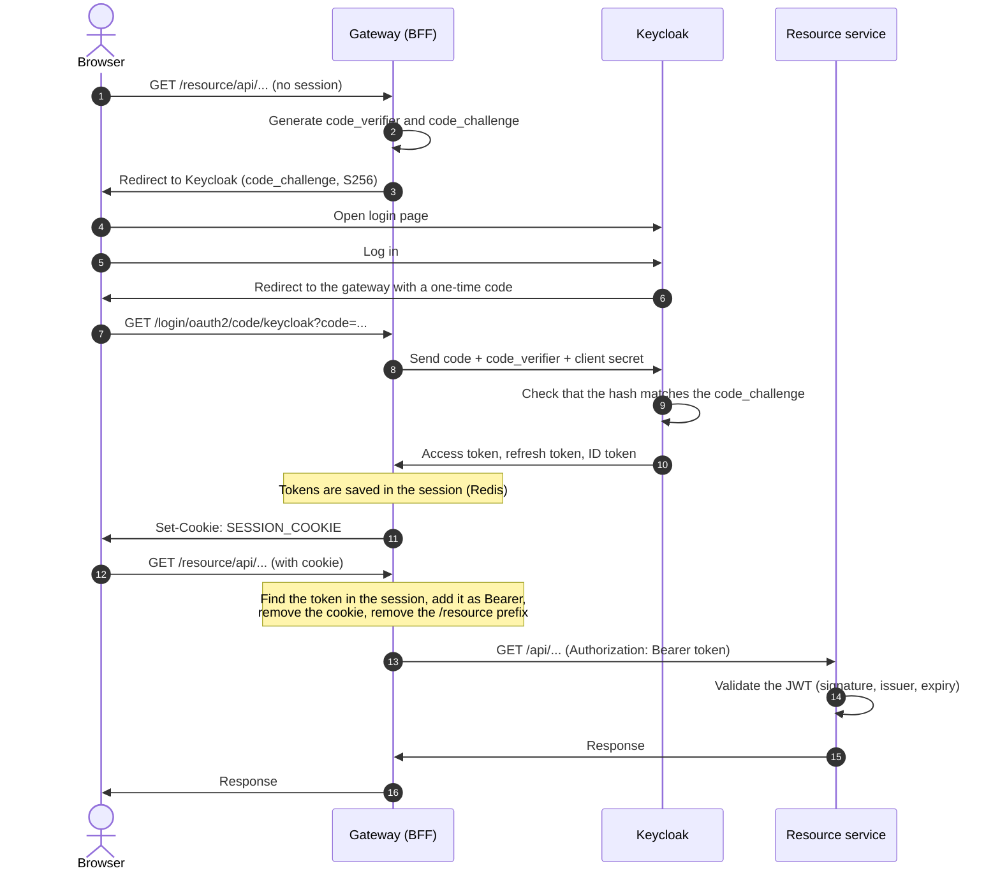

# 🍪 BFF + Authorization Code Flow with PKCE

A demo of the **Backend for Frontend (BFF)** pattern. The browser logs in with the **OAuth 2.0 Authorization Code Flow
with PKCE** but never sees a token: all tokens stay on the server.

Everything runs locally with Docker Compose.

## 🧩 Components

| Component                    | Role                                                                                                                                                       |
|:-----------------------------|:-----------------------------------------------------------------------------------------------------------------------------------------------------------|
| **Nginx**                    | TLS termination and routing: `https://auth.develop.local` → Keycloak, `https://develop.local` → Gateway.                                                   |
| **Keycloak**                 | Authorization server. Authenticates users (local accounts or GitHub), requires PKCE (`S256`) and the client secret, issues tokens.                         |
| **Config Server and Eureka** | Centralized configuration and Service discovery (the gateway resolves the resource service by name).                                                       |
| **Gateway** (BFF)            | Spring Cloud Gateway acting as the OAuth client. Runs the login with Keycloak, stores the tokens in the session and relays the access token to the API.    |
| **Resource service**         | Stateless resource server. Validates the JWT only. No login, no cookies.                                                                                   |
| **Redis**                    | Session store for the gateway, tokens included. Session lifetime: 30 minutes.                                                                              |

## 🤔 Why BFF?

**The problem.** In a regular single-page app the tokens live in the browser, so any malicious script on the page (XSS)
can read and steal them.

**The BFF idea.** A server-side component between the browser and the API acts as the OAuth client:

- It talks to Keycloak and obtains the tokens.
- It keeps the tokens on the server, in the session.
- It gives the browser only a session cookie (`HttpOnly`, `Secure`, `SameSite=Strict`), which JavaScript cannot read.

```text
Browser  ── cookie ──►  Gateway  ── Bearer token ──►  Resource service
(no tokens)             (tokens in session)           (checks the JWT)
```

## 🔑 How PKCE works

PKCE (Proof Key for Code Exchange, [RFC 7636](https://datatracker.ietf.org/doc/html/rfc7636)) binds the code to the
client that started the login:

1. **Start of login.** The client generates a random `code_verifier` and sends its hash, the `code_challenge`, in the
   authorization request. Keycloak stores the challenge.
2. **End of login.** The client sends the `code` together with the original `code_verifier`.
3. **Check.** Keycloak hashes the `code_verifier` and compares it with the stored `code_challenge`. If they match, it
   issues the tokens; otherwise it rejects the request.

```text
code_verifier  = dBjftJeZ4CVP-mB92K27uhbUJU1p1r_wW1gFWFOEjXk    stays in the client
code_challenge = E9Melhoa2OwvFrEMTJguCHaoeK1t8URWbuGJSstw-cM    sent to Keycloak
                 (code_challenge = BASE64URL(SHA256(code_verifier)))
```

A hash cannot be reversed, so an attacker who intercepts the `code_challenge` and the `code` still cannot get a token
without the `code_verifier`.

The gateway runs on the server, so it is a *confidential client* and also sends a `client_secret`. The secret proves who
the client is, and PKCE proves that the code is redeemed by the login that started it. Keycloak requires both (`S256`).

## 🔄 How it works



The gateway route does the last part:

```yaml
- id: service-resource
  uri: lb://service-resource Eureka
  predicates:
    - Path=/resource/api/**
  filters:
    - StripPrefix=1
    - TokenRelay=                     # add the access token as a Bearer token
    - RemoveRequestHeader=Cookie      # the cookie never reaches the resource service
```

## 🚀 Run it

You need Docker with Docker Compose.

**1. Add the host names** to your `hosts` file (`/etc/hosts` on Linux and macOS,
`C:\Windows\System32\drivers\etc\hosts` on Windows):

```text
127.0.0.1 develop.local auth.develop.local
```

**2. Make local HTTPS certificates** (example with [mkcert](https://github.com/FiloSottile/mkcert)):

```bash
mkcert -install
mkdir -p infra/certs/ssl infra/certs/ca

mkcert -cert-file infra/certs/ssl/develop.local.pem \
       -key-file  infra/certs/ssl/develop.local-key.pem  develop.local

mkcert -cert-file infra/certs/ssl/auth.develop.local.pem \
       -key-file  infra/certs/ssl/auth.develop.local-key.pem  auth.develop.local

cp "$(mkcert -CAROOT)/rootCA.pem" infra/certs/ca/rootCA.pem
```

**3. Create the `.env` file.** Copy ` .env.example` to `.env` and fill in the values:

| Variable                                                               | Value                                                                                                                                                                                            |
|:-----------------------------------------------------------------------|:-------------------------------------------------------------------------------------------------------------------------------------------------------------------------------------------------|
| `KC_BOOTSTRAP_ADMIN_USERNAME`, `KC_BOOTSTRAP_ADMIN_PASSWORD`           | Admin account for the Keycloak console                                                                                                                                                           |
| `KC_POSTGRES_DATABASE`, `KC_POSTGRES_USERNAME`, `KC_POSTGRES_PASSWORD` | Keycloak database                                                                                                                                                                                |
| `SERVICE_GATEWAY_KC_OAUTH2_CLIENT_SECRET`                              | Client secret shared by Keycloak and the gateway. Any long random string, for example `openssl rand -base64 32`                                                                                  |
| `SERVICE_GATEWAY_RD_DATABASE`                                          | Redis database number, for example `0`                                                                                                                                                           |
| `SERVICE_GATEWAY_RD_USERNAME`                                          | `default` (Redis here is protected by a password only)                                                                                                                                           |
| `SERVICE_GATEWAY_RD_PASSWORD`                                          | Redis password                                                                                                                                                                                   |
| `KC_IDP_GITHUB_CLIENT_ID`, `KC_IDP_GITHUB_CLIENT_SECRET`               | Credentials of your GitHub OAuth App, used by the "GitHub" login button. Set the app's callback URL to `https://auth.develop.local/realms/realm-bff/broker/github/endpoint`                      |

**4. Start everything:**

```bash
docker compose up -d --build
```

Wait a few minutes. Keycloak must start and import the realm first; the other services start after it.

## 🧪 Testing in the browser

### Step 1: Start the login

Open any endpoint of the resource service in your browser:

```text
https://develop.local/resource/api/<endpoint>
```

You have no session, so the gateway redirects you to the Keycloak login page.

### Step 2: Log in

Log in with `admin` / `admin` or `user` / `user`, or use the **GitHub** button. Keycloak redirects you back to the
gateway, and then to the address from Step 1. You get the response of the resource service.

### Step 3: Check what the browser knows

Open DevTools (`F12`):

- **Application → Cookies → `https://develop.local`**: there is a `SESSION_COOKIE`. It is `HttpOnly`, so JavaScript
  cannot read it. There is **no token** in cookies, local storage or session storage.
- **Network** (enable **Preserve log**, then repeat Step 1): the browser's requests have **no** `Authorization` header.
  The redirect to Keycloak contains `code_challenge` and `code_challenge_method=S256`.

The tokens are on the server, in the Redis session.
